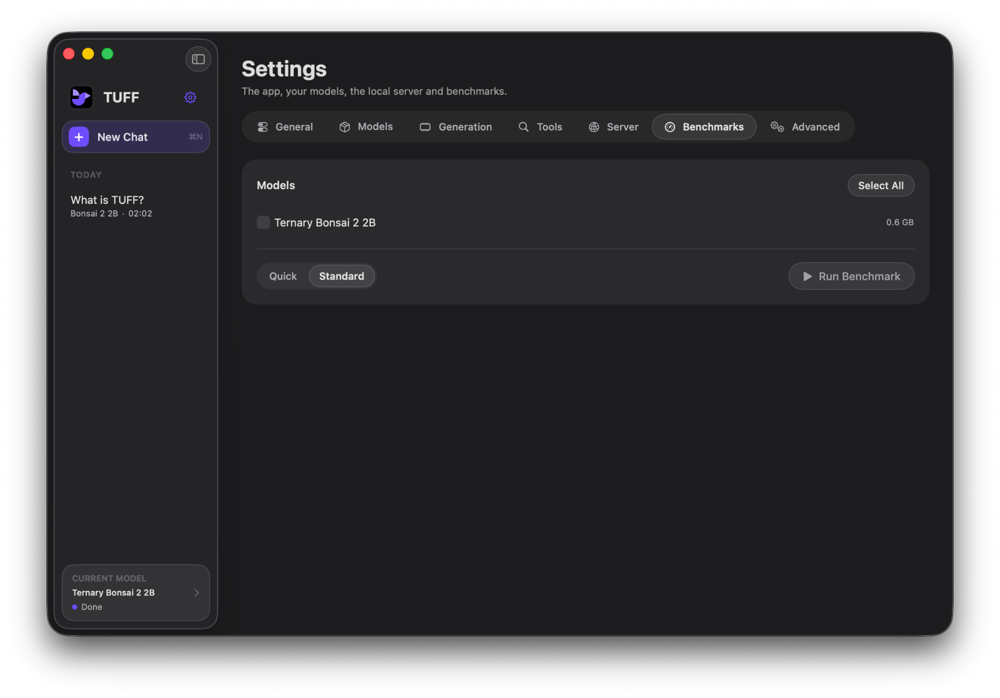

# Benchmarks

I only have one Mac, so TUFF's speed on everything else comes from you. The
benchmark is built in, takes a few clicks, and the results go on the
[leaderboard](https://tuff-app.github.io/benchmarks/).

## Run one

**In the app:** open **Settings > Benchmarks**, tick the models you want, and press
**Run Benchmark**. When it's done, press **Share on GitHub**.

Sharing opens a new post in the Benchmarks discussions. A short result is
filled in for you. A longer one, usually two or more models, is too big for
GitHub to fill in, so TUFF copies the whole post to your clipboard instead:
press Cmd-V in the body, then **Start discussion**. Paste that, not the
saved `.json` file, and leave the data block as it is.



**From the terminal:**

```sh
tuff bench --models gemma4,qwen36 --share
tuff bench --all --quick
tuff bench --list
```

Models run one at a time. Chat's model is unloaded first, and nothing else
should be running if you want clean numbers. Big models are slow on small
Macs: a standard run of MiniMax M2.7 on 16 GB takes well over an
hour. Stop it any time and you keep what finished. Results are saved in
TUFF's `Benchmarks` folder either way.

## What it measures

Every Mac runs the same fixed prompts (suite `tuff-bench` v1), with the
settings chat would use for that model on that Mac and a fixed seed.

| Test | What it tells you |
| --- | --- |
| Check | Asks for the capital of France. A wrong answer means the model is broken on that Mac. |
| Short | A short question with a 128-token answer. Gives **Writes**, the decode speed. |
| Long | A ~1,500-token document. Gives **Reads prompt** and **First token**. |
| Follow-up | A question about the long answer in the same chat. Shows how much prompt reuse saves. |

**Standard** runs the short and long tests three times and reports the
median. **Quick** runs each once. Each result also records load time, how
many tokens were reused, and the app's own memory (model weights are mapped
from disk, so they aren't counted).

## What gets shared

Your chip, memory, Mac model identifier (like `Mac14,2`), GPU core count,
macOS version, TUFF version, the settings used, and the timings. Nothing else:
no serial number, name, files or chats. You see the whole post before it's
published, and it's posted from your GitHub account, so you can edit or
delete it later.

## How results are checked

A bot reads each post in the
[Benchmarks discussions](https://github.com/tuff-app/TUFF/discussions/categories/benchmarks)
and labels it:

- **community:** the data is well formed, matches the published prompts, and
  looks plausible. It's on the leaderboard.
- **needs review:** something looks off (much faster than similar Macs, a
  failed check, a brand-new account, lots of posts in a day). I'll look at it.
- **rejected:** malformed, edited, or a copy of another post. The bot says
  why, and editing the post re-runs the checks.
- **verified:** I reproduced it or checked it by hand.

The leaderboard counts each person once per model, Mac and version, using
their median, so posting the same run many times doesn't move anything.

None of this proves a result is real. Someone determined could fake one. The
checks catch mistakes, copies and obvious nonsense, and every number links
back to the post it came from.

## For maintainers

The checks live in `Scripts/benchmark_discussions.py` and run from the
Benchmark review workflow on every new or edited post. The
[website](https://github.com/tuff-app/tuff-app.github.io) rebuilds the
leaderboard from the reviewed posts every hour, so a new result can take up to
an hour to appear. No results are stored in the repository. Changing a prompt
or limit in `AppBenchmarkSuite.swift` changes the workload hash; bump the
suite version and add the new hash to `.github/benchmark-suite.json`.
